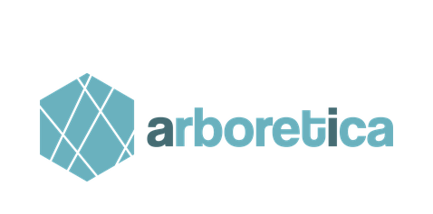
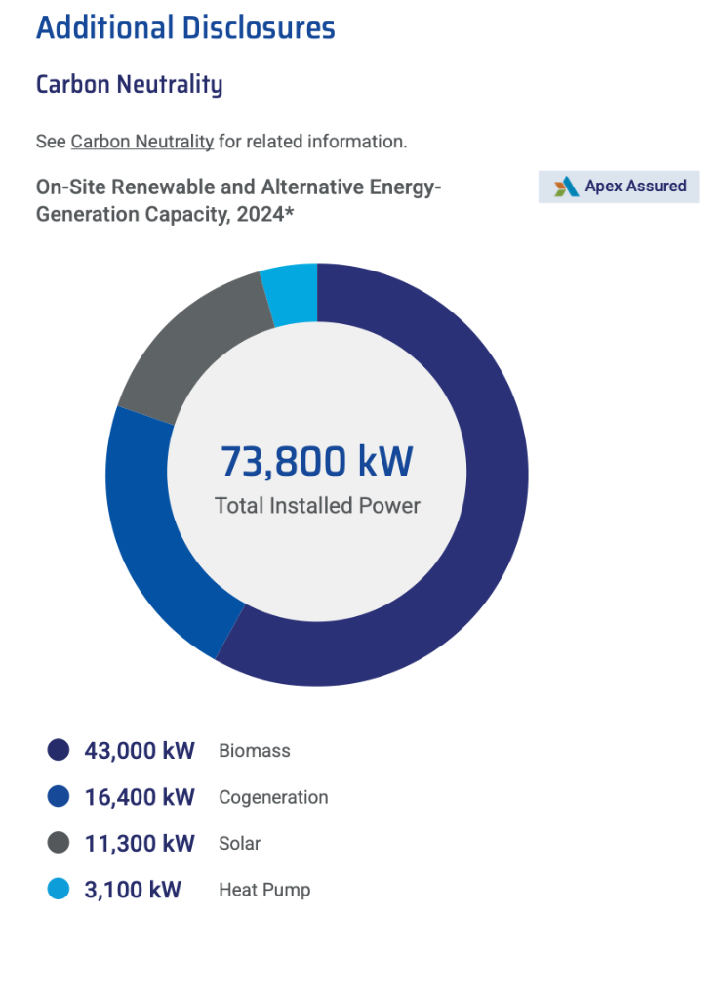
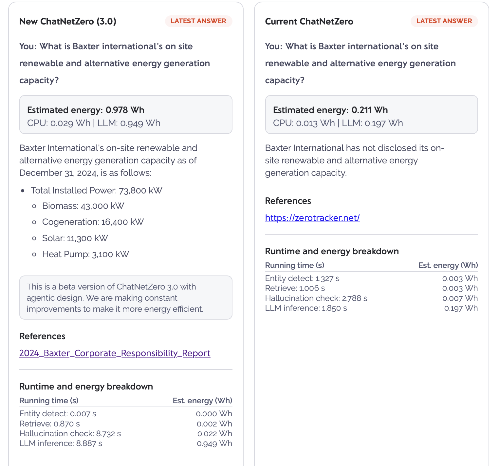
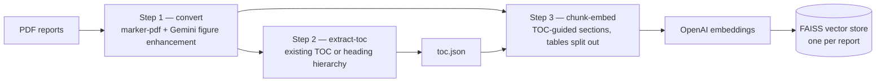

<h1 align="center">pdf_pipeline</h1>
<p align="center">
  <b>Turn PDF reports into searchable FAISS vector stores — in three commands.</b>
</p>

<p align="center">
  <a href="https://github.com/arboretica/pdf_pipeline/stargazers"></a>
  <a href="https://pypi.org/project/pdf-pipeline/"></a>
  <a href="https://github.com/arboretica/pdf_pipeline/actions/workflows/ci.yml"></a>
  
  <a href="LICENSE"></a>
  <a href="https://github.com/arboretica/pdf_pipeline/issues"></a>
  <a href="https://github.com/arboretica/pdf_pipeline/issues?q=is%3Aopen+is%3Aissue+label%3A%22good%20first%20issue%22"></a>
</p>

<p align="middle">
  
</p>

> ⭐️ **If this project helps you, please give it a star!** Stars help others discover it.

---

## Why it matters: a real-world example

Standard PDF-to-text extraction drops data that lives in charts and infographics. `pdf_pipeline` transcribes figure pages with Gemini vision and keeps tables intact during chunking, so that data becomes retrievable.

**Source:** [Baxter 2024 Corporate Responsibility Report](https://p1.aprimocdn.net/hillrom/6fb27434-6774-4ee1-854a-b3af014c7c54/2024_Baxter_Corporate_Responsibility_Report_Original%20file.pdf) (PDF)
**Question:** *"What is Baxter International's on-site renewable and alternative energy generation capacity?"*

| | Answer |
|---|---|
| **ChatNetZero 3.0** (`pdf_pipeline` ingestion) | Total installed power **73,800 kW** — biomass 43,000, cogeneration 16,400, solar 11,300, heat pump 3,100 kW, with a citation to the report |
| **Current ChatNetZero** (previous ingestion) | "Baxter International has not disclosed its on-site renewable and alternative energy generation capacity." |

The figure holding these numbers was an infographic, not body text — it only became retrievable because the figure page was transcribed and chunked as a table.

<table align="center">
  <tr>
    <th>Source figure in the Baxter report</th>
    <th>Retrieval result</th>
  </tr>
  <tr>
    <td valign="top"></td>
    <td valign="top"></td>
  </tr>
</table>

<sub>Live comparison: <a href="https://new.chatnetzero.ai/demo/">new.chatnetzero.ai/demo</a>. Energy and runtime figures in the screenshot are from the ChatNetZero demo, not this package.</sub>

---

## What is pdf_pipeline?

A three-step Python pipeline that converts PDF reports into searchable vector stores.

1. **Convert** — turns PDFs into clean markdown using [marker-pdf](https://github.com/VikParuchuri/marker), then enhances figure-heavy pages with Google Gemini vision.
2. **Extract TOC** — detects or builds a structured table of contents from each markdown report.
3. **Chunk & Embed** — splits markdown into semantically meaningful chunks guided by the TOC, embeds them with OpenAI, and saves per-report [FAISS](https://github.com/facebookresearch/faiss) vector stores.

> **TL;DR**: PDFs in → 3 commands → searchable per-report FAISS vector stores out.

---

## Features

- **Hybrid conversion** — marker-pdf for structure, Gemini vision transcription for figure-heavy pages
- **TOC-aware chunking** — reuses the document's own table of contents when present (≥ 3 entries), falls back to heading hierarchy
- **Section breadcrumbs** — every chunk carries its section title, parent sections, and breadcrumb for retrieval context
- **Tables kept intact** — tables are separated into their own chunks instead of being shredded
- **One FAISS store per report** — query reports independently
- **Keyless previews** — `chunk-embed --dry` shows exactly what would be embedded, no API key required
- **Bundled smoke test** — `pdf-pipeline smoke-test` runs the pipeline on sample data without any keys
- **Sensible key handling** — CLI flags → environment variables → `.env` file, with nothing logged
- **Proven on real reports** — see [Why it matters](#why-it-matters-a-real-world-example)

---

## How it Works



---

## Requirements

- **Python 3.10+**
- API keys for **Google Gemini** (Step 1) and **OpenAI** (Step 3)

## Installation

**From PyPI** (recommended):

```bash
pip install pdf-pipeline
```

> **Heads-up on download size:** Step 1 uses [marker-pdf](https://github.com/VikParuchuri/marker), which pulls in PyTorch, so the first install is large. On a machine without a GPU, pre-installing the CPU-only PyTorch wheel keeps the download much smaller:
>
> ```bash
> pip install torch --index-url https://download.pytorch.org/whl/cpu
> pip install pdf-pipeline
> ```

**From source** (for development):

```bash
git clone https://github.com/arboretica/pdf_pipeline.git
cd pdf_pipeline
pip install -e .
```

All Python dependencies are declared (with pinned minimum versions) in `pyproject.toml` and installed automatically. `requirements.txt` is a one-line convenience wrapper (`-e .[dev]`) that also installs dev tools such as `pytest`.

---

## Quick Start

```bash
# 1. Install
pip install pdf-pipeline

# 2. Supply API keys (pick one method)
#    a) CLI flags   --google-api-key / --openai-api-key
#    b) Env vars    export GOOGLE_API_KEY=... && export OPENAI_API_KEY=...
#    c) .env file   cp .env.example .env  (then edit)

# 3. Run the pipeline
pdf-pipeline convert     --pdf-dir ./pdfs --output-dir ./md_output --google-api-key <KEY>
pdf-pipeline extract-toc --markdown-dir ./md_output --output-json ./toc.json
pdf-pipeline chunk-embed --markdown-dir ./md_output --toc-json ./toc.json --output-dir ./faiss_stores --openai-api-key <KEY>
```

## Sample Data & Smoke Test

No PDFs handy? The package bundles a tiny synthetic sample (a 1-page PDF and a marker-style markdown fixture) and a smoke-test command:

```bash
pdf-pipeline smoke-test                 # Steps 2 + 3 (keyless, seconds)
pdf-pipeline smoke-test --with-convert   # also runs marker-pdf on the sample PDF
```

`--with-convert` requires the `marker` CLI and downloads OCR models on first use. Outputs land under `smoke_test_output/`.

---

## Usage

Every command is a subcommand of `pdf-pipeline`. Run `pdf-pipeline --help` for the full list. Increase verbosity with `-v` (INFO) or `-vv` (DEBUG) **before** the subcommand:

```bash
pdf-pipeline -vv chunk-embed --markdown-dir ./md_output --toc-json ./toc.json --output-dir ./faiss_stores --dry
```

### Step 1 — Convert PDFs to Markdown

```bash
pdf-pipeline convert \
    --pdf-dir ./pdfs \
    --output-dir ./markdown_output \
    --google-api-key YOUR_KEY
```

| Flag | Description |
|---|---|
| `--pdf-dir` | Directory containing the source PDF files **(required)** |
| `--output-dir` | Where marker-pdf writes its markdown output **(required)** |
| `--google-api-key` | Gemini API key (falls back to `GOOGLE_API_KEY` env var) |
| `--gemini-model` | Gemini model name (default: `gemini-2.0-flash`, from `config.py`) |
| `--marker-only` | Only run marker-pdf, skip Gemini enhancement |
| `--enhance-only` | Only run Gemini enhancement (marker output must already exist) |

**What it does:**

1. Runs `marker-pdf` over every PDF in `--pdf-dir`, producing one markdown directory per file.
2. Scans each directory for pages that contain figures (`_page_N_Figure_*.jpeg`).
3. Sends those pages to Gemini as single-page PDFs and inserts the returned markdown before the figure references.

### Step 2 — Extract Table of Contents

```bash
pdf-pipeline extract-toc \
    --markdown-dir ./markdown_output \
    --output-json ./toc.json \
    --output-md ./toc.md        # optional
```

| Flag | Description |
|---|---|
| `--markdown-dir` | Directory containing markdown report sub-directories **(required)** |
| `--output-json` | Path for the structured TOC JSON file **(required)** |
| `--output-md` | Optional path for a human-readable combined TOC markdown file |

**What it does:**

For each report directory it first looks for an existing TOC section in the markdown. If found (≥ 3 entries) it uses that; otherwise it builds a TOC from the document's heading hierarchy. Results are saved as JSON for use by Step 3.

### Step 3 — Chunk & Embed into FAISS

```bash
pdf-pipeline chunk-embed \
    --markdown-dir ./markdown_output \
    --toc-json ./toc.json \
    --output-dir ./faiss_stores \
    --openai-api-key YOUR_KEY
```

| Flag | Description |
|---|---|
| `--markdown-dir` | Directory containing markdown report sub-directories **(required)** |
| `--toc-json` | TOC JSON produced by Step 2 **(required)** |
| `--output-dir` | Where FAISS stores are saved (one sub-directory per report) **(required)** |
| `--openai-api-key` | OpenAI API key (falls back to `OPENAI_API_KEY` env var; **not required for `--dry`**) |
| `--embedding-model` | OpenAI embedding model (default: `text-embedding-3-small`, from `config.py`) |
| `--max-chunk-size` | Max chunk size in characters (default: `1500`, from `config.py`) |
| `--chunk-overlap` | Overlap between chunks in characters (default: `200`, from `config.py`) |
| `--skip` | Report name to skip (repeatable) |
| `--dry` | Preview chunks without embedding or saving — works **without an API key** |

**What it does:**

1. Loads the TOC JSON and infers a section hierarchy for each report.
2. Splits each report's markdown into sections, then separates tables from text.
3. Applies recursive character splitting to oversized text chunks.
4. Embeds all chunks with OpenAI and saves one FAISS index per report.

---

## Configuration

All tunables live in [`src/pdf_pipeline/config.py`](src/pdf_pipeline/config.py):

| Setting | Default | Used by |
|---|---|---|
| `GEMINI_MODEL` | `gemini-2.0-flash` | Step 1 figure transcription |
| `EMBEDDING_MODEL` | `text-embedding-3-small` | Step 3 embeddings |
| `MAX_CHUNK_SIZE` | `1500` | Step 3 chunking |
| `CHUNK_OVERLAP` | `200` | Step 3 chunking |
| `GOOGLE_API_KEY_ENV` | `GOOGLE_API_KEY` | Key fallback resolution |
| `OPENAI_API_KEY_ENV` | `OPENAI_API_KEY` | Key fallback resolution |

CLI flags override these values. Edit `config.py` to change the defaults for every command at once.

## API Key Precedence

For both `--openai-api-key` and `--google-api-key`:

| Priority | Source |
|---|---|
| 1 (highest) | CLI argument |
| 2 | Environment variable (`OPENAI_API_KEY` / `GOOGLE_API_KEY`) |
| 3 | `.env` file (auto-loaded via `python-dotenv`) |

---

## Project Structure

```
pdf_pipeline/
├── LICENSE                        # MIT license
├── CONTRIBUTING.md                # How to contribute
├── SECURITY.md                    # Vulnerability reporting policy
├── CHANGELOG.md                   # Release history (Keep a Changelog format)
├── pyproject.toml                 # Package metadata & pinned dependencies
├── requirements.txt               # One-liner: editable install incl. [dev] extra
├── .env.example                   # API key template
├── .github/workflows/             # CI tests + tag-driven PyPI release workflow
├── docs/
│   └── examples/baxter-2024/      # Real-world retrieval comparison shown in the README
├── src/
│   └── pdf_pipeline/
│       ├── __init__.py            # Version
│       ├── config.py              # All tunables (models, chunk sizes, env-var names)
│       ├── cli.py                 # Click CLI (convert, extract-toc, chunk-embed, smoke-test)
│       ├── convert.py             # Step 1 — PDF → Markdown
│       ├── extract_toc.py         # Step 2 — TOC extraction
│       ├── chunk_embed.py         # Step 3 — Chunk & embed
│       └── samples/               # Bundled smoke-test data (sample PDF + markdown fixture)
└── tests/                         # Pytest suite
    ├── test_extract_toc.py
    ├── test_config.py
    └── test_cli.py
```

---

## Troubleshooting

- **marker-pdf runs out of memory or is very slow** — marker loads OCR models; on low-RAM machines close other GPU/memory-heavy jobs and process one batch of PDFs at a time. Use `--marker-only` to separate conversion from Gemini enhancement.
- **Gemini/OpenAI quota or `429` errors** — you are hitting API rate limits or a billing cap. Wait and retry, or process fewer pages/reports per run. `--dry` previews chunking without calling any API.
- **`marker: command not found`** — the `marker` CLI ships with the `marker-pdf` dependency; re-run `pip install pdf-pipeline` (or `pip install -e .` for a source checkout) with your virtual environment active.
- **`No markdown file found for <report>`** — Step 2 expects marker-style layout: `<markdown-dir>/<report>/<report>.md` (or `<report>_updated.md`).
- **`OMP: Error #15` / duplicate OpenMP library warnings on macOS** — already suppressed internally (`KMP_DUPLICATE_LIB_OK`); no action needed.

---

## Development

```bash
# Install in editable mode with dev tools (pytest)
pip install -e ".[dev]"

# Run tests
pytest tests/ -v

# Keyless end-to-end check on the bundled sample
pdf-pipeline smoke-test

# Verify CLI
pdf-pipeline --help
```

## Contributing

Issues and PRs are welcome! See [CONTRIBUTING.md](CONTRIBUTING.md) for setup, coding standards, where to make changes, and the PR checklist.

## Security

Found a vulnerability? Please report it privately — see [SECURITY.md](SECURITY.md). Do not open public issues for security problems.

---

## License

MIT License — see the [LICENSE](LICENSE) file for details.
Copyright (c) 2026 **Arboretica**.

---

## Authors

- Developed by **Mariam Abuelfotouh**, 2026
- Copyright ownership: **Arboretica**

---

## Acknowledgements

- [marker-pdf](https://github.com/VikParuchuri/marker) for PDF-to-markdown conversion
- [Google Gemini](https://ai.google.dev/) for figure-page transcription
- [OpenAI](https://openai.com/) for text embeddings
- [FAISS](https://github.com/facebookresearch/faiss) for efficient vector search
- [LangChain](https://github.com/langchain-ai/langchain) for chunking and vector-store tooling
